# EL05 Controller 利用者マニュアル

EL05 Controller は、RobStride EduLite 05(EL05)を机の上で回し、その応答をグラフで確かめ、パラメータを読み書きするためのツールです。
PC とモータは USB-CAN アダプタでつなぎます。モータが手元になくても、シミュレータ(`run_sim.bat`)で同じ画面を操作できます。

机に置いただけの、固定していないモータでも試せます。
そのためにアプリは、起動時の出力段階を「低出力」に絞り、すべての指令をその上限で制限します。
ただ、実機で試してみると、上限だけでは抑えきれない動きがいくつか見つかりました。
モータを回す前に、§3「安全のしくみ」で、それがどんな場面か、アプリがどう備えているかを確かめてください。

読者には、EL05 を初めて机に置いた人を想定しています。ターミナルでコマンドを実行できることは前提にしています。

## 目次

1. [必要なものと初回起動](#1-必要なものと初回起動)
2. [画面の見かた](#2-画面の見かた)
3. [安全のしくみ(最初に読んでください)](#3-安全のしくみ最初に読んでください)
4. [モータを回すには(モードごとの使い方)](#4-モータを回すにはモードごとの使い方)
5. [グラフの道具](#5-グラフの道具)
6. [パラメータページ](#6-パラメータページ)
7. [診断ページ](#7-診断ページ)
8. [保守ページ](#8-保守ページ)
9. [スクリプトページ(コンソールとシーケンス)](#9-スクリプトページコンソールとシーケンス)
10. [CLI(コマンドライン)](#10-cliコマンドライン)
11. [設定ページ](#11-設定ページ)
12. [トラブルシューティング](#12-トラブルシューティング)
13. [既知の制限・未確認の項目](#13-既知の制限未確認の項目)
14. [付録: キーボードショートカット](#14-付録キーボードショートカット)

---

## 1. 必要なものと初回起動

### 1.1 用意するもの

| もの | メモ |
|---|---|
| Windows PC | 主な動作環境です。Linux 用には `run.sh` があります |
| [uv](https://docs.astral.sh/uv/) | Python の管理ツール。Python 3.12 は uv が自動で用意します |
| 公式 USB-CAN アダプタ(CH340) | USB シリアルとして見えます(`COM7` など)。VID:PID は 1A86:7523 |
| EL05 本体 + 直流電源 | 使用電圧は 15–60 V、定格は 48 V です |

uv は、次のどちらかでインストールします。

```
winget install --id=astral-sh.uv -e
powershell -ExecutionPolicy ByPass -c "irm https://astral.sh/uv/install.ps1 | iex"
```

### 1.2 起動するには

プロジェクトのフォルダにある次の 3 つが入口です。

| 目的 | 起動方法 |
|---|---|
| 実機をつなぐ | `run.bat` をダブルクリック |
| モータ無しで試す(シミュレータ) | `run_sim.bat` をダブルクリック |
| 画面の見た目だけ確認する(ダミーデータ) | `run.bat --demo`(または `run_sim.bat --demo`) |

コマンドラインから起動するときは、次のように実行します。

```
uv run --frozen python -m edulite05              # 実機(未接続で起動)
uv run --frozen python -m edulite05 --sim        # シミュレータ(2 台: ID 127 と 1)
uv run --frozen python -m edulite05 --demo       # ダミーデータ(UI 確認用)
```

起動オプション:

| オプション | 意味 |
|---|---|
| `--sim [N]` | 本物の制御コア + 模擬モータ N 台(既定 2 台、ID は 127 と 1)。起動時に自動で接続します |
| `--demo` | ダミーデータで動く画面確認用。実機にもシミュレータにもつながりません。`--no-demo` で起動時のデモ動作を止められます |
| `--start-offline` | 未接続から始めます(接続 → 自動スキャンの流れを試せます) |
| `--lang ja` / `--lang en` | 表示言語。環境変数 `EDULITE05_LANG` でも指定できます |
| `--no-3d` | 3D 表示を使わず、2D のダイヤルだけにします |
| `--reset-layout` | 保存済みのウィンドウ配置を使いません |
| `--gallery` | 画面部品の見本(開発用)を開きます |

起動すると、まず小さな「読み込み中」のウィンドウが出ます。
メインウィンドウが出るまでの目安は数秒です。
3D 表示は、そのあと読み込みが終わった時点で自動で切り替わります。

### 1.3 Python の環境

Python の環境(`.venv`)は、uv がプロジェクトの直下に作ります。初回だけ、依存パッケージの取得に時間がかかります。

- プロジェクトはローカルのディスクに置いてください。ネットワーク共有の上に置くと、import に 40–60 秒かかります。

### 1.4 公式 USB-CAN アダプタをつなぐ

1. アダプタを PC の USB につなぎます。デバイスマネージャーの「ポート(COM と LPT)」に `USB-SERIAL CH340 (COM7)` のように出ます。出ないときは CH340 のドライバを入れます。
2. アダプタの DIP スイッチを確認します。
   - スイッチ 2 = ON: 120 Ω の終端抵抗をつなぎます(通信に必要です)。
   - スイッチ 1 = OFF: ON にすると Boot モードになり、つながりません。
3. アダプタの CANH / CANL をモータの CAN 端子へ配線します。
4. モータに電源を入れます。
5. `run.bat` でアプリを起動し、ヘッダーの [接続] を押します。
6. 接続ポップオーバーで、アダプタ「公式 USB-CAN(AT)」とポートを選びます。CH340 のポートには ★ が付き、先頭に出ます。
7. [接続] を押します。アプリが自動でモータを探します。

CAN は 1 Mbps、ホスト ID は 0xFD です(通常は変更不要)。
COM ポートは 1 つのアプリしか開けないので、MotorStudio など、ほかのツールは閉じておきます。

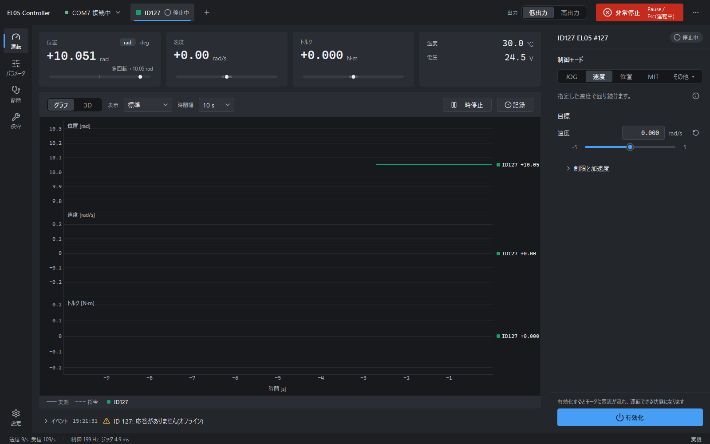

#### ほかのアダプタ・ログ再生

接続ポップオーバーの「アダプタ」には、公式 USB-CAN(AT)とシミュレータのほかに、次の 2 つがあります。

| アダプタ | 設定 | 備考 |
|---|---|---|
| 汎用 CAN(python-can) | インタフェース(slcan / gs_usb / candle / pcan / socketcan / virtual。一覧にないものは直接入力)、チャネル(例: COM5 / PCAN_USBBUS1 / can0)、ビットレート | python-can は任意の追加機能です。入っていないときは「使用不可」と灰色で出て、理由(`uv sync --extra pycan` で導入)が下に表示されます。公式 USB-CAN はこの方式では扱えないので、「公式 USB-CAN(AT)」を選びます |
| ログ再生(読み出し専用) | フレームログ(candump -L 形式)を [参照…] で選び、再生速度(0.25〜10 倍)と繰り返しを選びます | 記録したログの受信フレームを、元の時間間隔で流します。ログを選ぶまで [接続] は押せません |

ログ再生中、アプリはモータへ何も送りません。
画面には青い帯「ログ再生中(送信しません)」が出続け、ステータスバーの接続先は「ログ再生」になります。
モータの一覧にはログに現れた ID が並び、グラフ、CSV の記録、診断のフレーム一覧は使えます。
一方、有効化・運転・JOG・パラメータの読込と書込・保守の操作は押せなくなります(理由はツールチップに出ます)。
ログの最後まで再生すると、モータは「未接続」になります。繰り返しを選んでいれば先頭へ戻ります。

### 1.5 電源についての注意

| 項目 | 内容 |
|---|---|
| 電圧 | 使用範囲は 15–60 V。24 V でも動きます(実機で確認済み) |
| 最高速度 | 電圧に比例して下がります。24 V では約 23.5 rad/s で頭打ちになります(48 V の無負荷は約 45 rad/s) |
| 電流 | 1 A の電源は、低速・低出力の軽い試験専用です。急加速・急減速で電源が電流制限にかかると、電圧が下がって低電圧故障(12 V 未満)になることがあります |
| 本格的な試験 | 高出力(§3.1)や高速回転には、容量に余裕のある電源が要ります(ベンチでは 24 V 6.25 A のスイッチング電源を使用) |
| 回生 | 外から手で回すと、モータが発電して電源側へ電力が戻ります。24 V 電源なら、過電圧(60 V)までは余裕があります |

### 1.6 最初の 5 分(おすすめの手順)

1. `run_sim.bat` で起動し、運転ページで [速度] → 目標 `0.5` → [有効化] → [運転開始] → [運転停止] → [無効化] と進めます。ここで画面の流れを覚えます。
2. 実機では、モータを机に置いたまま(固定しなくてよい)`run.bat` で起動して接続します。出力段階は低出力のままにします。
3. 同じ手順で、速度 0.5 rad/s を数秒だけ回します。回す前に、ハンドルなどが回る範囲に物や手がないことを確かめます。
4. 慣れたら、JOG、位置、MIT へ進みます(§4)。

---

## 2. 画面の見かた

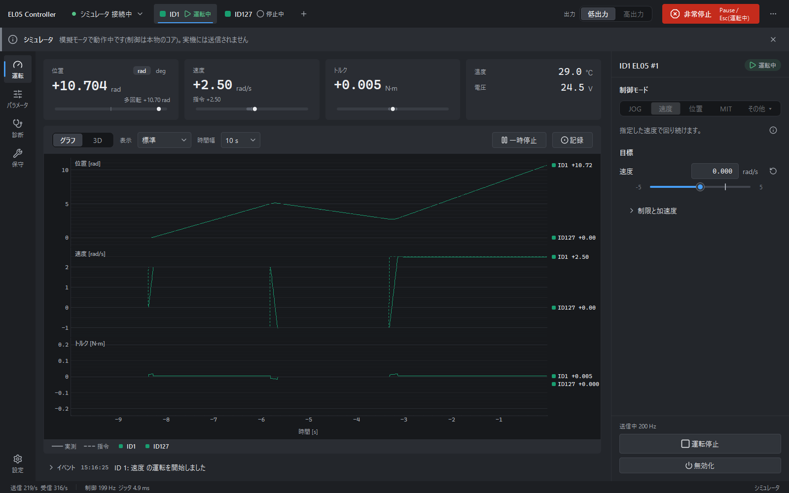

画面は、上から「ヘッダー」「バナー」「ページ本体(左にナビ)」「イベント行」「ステータスバー」でできています。

### 2.1 ヘッダー(常に表示)

左から順に、次の部品が並びます。

| 部品 | 働き |
|---|---|
| 接続ボタン(`● COM7 接続中 ▾` / `○ 未接続 ▾`) | 押すと接続ポップオーバーが開きます。接続中は [モータを再スキャン] [切断] も出ます |
| モータチップ(`■ID127 ○停止中` など) | モータ 1 台につき 1 個。クリックしたモータが操作対象になります。色はグラフ・3D と共通です。状態は「未接続 / 停止中 / 有効 / 運転中 / 故障」のどれかです |
| `+` | モータを再スキャンします(有効なモータがあるときはスキャンしません) |
| 出力 [低出力 \| 高出力] | 出力段階の切替(§3.1)。高出力のときだけ琥珀色になります |
| [非常停止] | 赤いボタン。全モータを即座に無効化し、その状態を保持(ラッチ)します(§3.2) |
| `⋯` | 資料フォルダを開く、バージョン情報、プラグインが足した項目。シミュレータでは「デモ」メニューから故障や通信断を模擬的に起こせるので、非常時の画面を試せます |

### 2.2 バナー(必要なときだけ出る帯)

バナーは、出た条件が解消するまで消えません。複数あるときは、上の行ほど優先度が高くなります。

| 優先 | バナー | 意味と操作 |
|---|---|---|
| 1 | 赤「非常停止中 全モータの出力を止めました」 | [非常停止を解除…] で解除します(§3.2) |
| 2 | 赤「ID○ に故障があります」 | [原因を確認] で診断ページの「故障」へ移ります(§7.1) |
| 3 | 赤「アダプタとの通信が途絶えました」 | ケーブルと電源を確認して [再接続] を押します。全モータは未接続扱いになり、出力段階は低出力に戻ります(§12.4) |
| 4 | 琥珀「高出力モード モータを固定して使用してください」 | [低出力に戻す] ですぐに戻せます |
| 5 | 青「ログ再生中(送信しません)」 | ログ再生で接続しているときに出ます(§1.4)。閉じられません |
| 6 | 青「シミュレータ」 | 模擬モータで動作中です。実機には何も送りません(閉じられます) |

### 2.3 ナビゲーション(左のレール)

| ページ | 用途 | 節 |
|---|---|---|
| 運転 | 回す、グラフで見る(最もよく使う) | §4、§5 |
| パラメータ | モータの設定値を読む・書く | §6 |
| 診断 | 故障・ログ・CAN フレーム・通信統計 | §7 |
| 保守 | ゼロ点、CAN ID、ボーレートなど、たまに行う設定 | §8 |
| スクリプト | Python コンソールと、YAML の手順(シーケンス) | §9 |
| (プラグインのページ) | 同梱のサンプル「三角波」など | §11.1 |
| 設定(最下部) | テーマ、言語、プラグインなど | §11 |

診断ページにまだ見ていない故障があるときは、ナビに赤い点が付きます。
`Ctrl+1`, `Ctrl+2`, … で、ナビの上から順にページを切り替えられます。

### 2.4 運転ページ

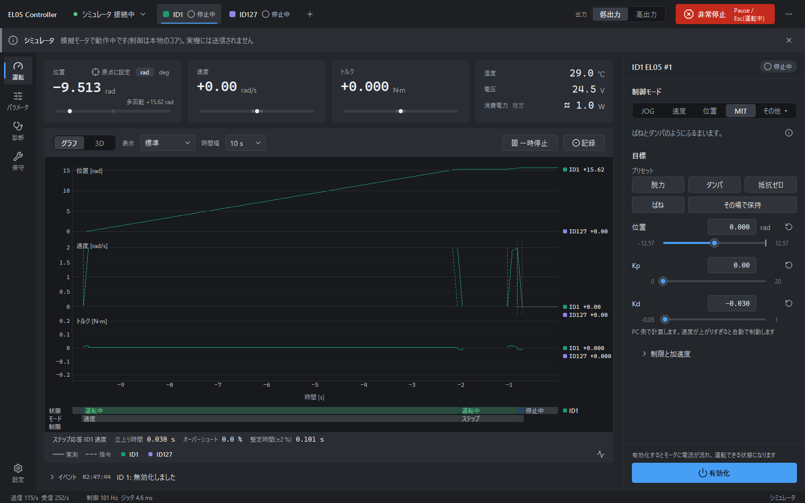

運転ページは、左の「モニタ」と右の「インスペクタ」(操作パネル)でできています。
境界をドラッグすると、インスペクタの幅を変えられます。

**読み値カード**(上の 4 枚。操作対象のモータの値)

| カード | 表示 |
|---|---|
| 位置 | 大きな数字は折り返し位置(±4π で折り返す値。§3.4)。下の小さな「多回転 x」は、何周回ったかを含む累計の位置です。`rad / deg` で単位を切り替えます |
| 速度 | 速度。下に「指令 x.xx」 |
| トルク | トルク(N·m)。下に「指令」 |
| 温度・電圧 | 温度(℃)と母線電圧(V)。3 行目に「消費電力 推定」 |

- 各カードの横バーは、全幅が物理的な範囲、薄い帯がいまの出力段階で許される範囲を表します。◆ が指令、● が実測です。
- 位置カードの [⊕ 原点に設定] は、現在位置を 0 にします(§3.4、§8.1)。
- 消費電力(推定)は、トルクと速度から概算した目安です。バスの電流は測っておらず、相抵抗・基本消費の係数が未較正なので、傾向を見るためだけに使い、電源の選定などには使わないでください。負の値は回生で、「回生 ≈ x W」と出ます。
- 入力が出力段階の上限で制限されているときは、カードに琥珀色で「低出力上限で制限中」と出ます。

**モニタ**

- `[グラフ | 3D]` で表示を切り替えます。3D はモータを横に並べ、モータの色のリングで見分けます。
- グラフは、1 つの量につき 1 段で縦に並びます。色がモータ、実線が実測、破線が指令です。
- グラフの下には、状態の帯(§5.6)、ステップ応答の 1 行、凡例の行が常に表示されます。

**イベント行**(モニタの下端): 最新のイベントを 1 件表示します。クリックすると診断ページのイベントログへ移ります。

**インスペクタ**(右)

1. 見出し `ID127 EL05 #127` と状態バッジ。
2. 制御モード: `[JOG] [速度] [位置] [MIT] [その他 ▾]`。「その他」には、電流(トルク)、試験信号、2台連動(モータが 2 台以上のとき)が入ります。モードを切り替えられるのは、モータが停止中(無効)のときだけです。
3. 目標: そのモードの目標値。
4. ▸ 制限と加速度(折りたたみ): 電流制限・加速度・送信周期など。
5. 最下部の主ボタン。モータの状態によって、次のように変わります。

| モータの状態 | 主ボタン | もう 1 つのボタン |
|---|---|---|
| 停止中 | 有効化 | |
| 有効(待機) | 運転開始(JOG のときは「押している間」ボタン 2 つ) | 無効化 |
| 運転中 | 運転停止 | 無効化 |
| 故障 | 故障をリセット | |

### 2.5 有効化・運転開始・非常停止の違い

モータを止める操作は 3 種類あり、止めたあとのモータの状態が違います。

| 操作 | 意味 | 操作後の状態 |
|---|---|---|
| 有効化 / 無効化 | モータの出力を ON / OFF にします。有効化するとモータに電流が流れます | 有効 / 停止中 |
| 運転開始 / 運転停止 | 指令を送り始める / やめます。運転停止のあとも、モータは速度 0 または現在位置の保持を続けます | 運転中 / 有効 |
| 非常停止 | 全モータを即座に無効化し、解除するまで操作を受け付けません(§3.2) | 停止中(ラッチ) |

このマニュアルで「停止中(無効)」と書くときは、無効化されて出力が OFF の状態を指します。運転停止しただけの状態(有効)とは別です。

### 2.6 ステータスバー(最下行)

| 表示 | 意味 |
|---|---|
| 送信 n/s 受信 n/s | CAN フレームの送受信レート |
| 制御 200 Hz ジッタ x ms | 制御ループの周期と、そのばらつき |
| 実機 / シミュレータ / モック / ログ再生 | いまの接続先 |

---

## 3. 安全のしくみ(最初に読んでください)

モータへの指令は、画面・CLI・スクリプトのどこから出しても、すべて「安全制限」(内部名 SafetyGuard)を通ります。
安全制限は、いまの出力段階の上限を超える指令を、上限に制限します。
この関門を通らずにモータへ指令を送る経路は、アプリにはありません。

上限で制限していれば、低出力のモータは手で持っても安全なはずでした。
ほとんどの場面では、実際にそうなります。
ところが実機で試すと、上限だけでは抑えきれない場面が三つ見つかりました。
電流モードでは、モータ側の速度制限が働きません(§3.3)。
多回転の位置が ±4π を超えると、MIT の位置目標をモータがどう解釈するかが分からなくなります(§3.4)。
手で急に動かした瞬間には、トルクが上限を超えます(§3.5)。
アプリは、それぞれに追加の規則で備えています。

### 3.1 出力段階: 低出力と高出力

出力段階は、安全制限が使う上限の組です。低出力(LOW)と高出力(HIGH)の 2 段階があり、起動時は必ず低出力です。

| 項目 | 低出力(既定) | 高出力 |
|---|---|---|
| 想定 | 固定しなくてよい。手で持っても試せる | モータを固定して使う |
| トルク | 0.5 N·m まで | 6 N·m まで |
| 電流 | 1 A まで | 11 A まで |
| 速度 | 5 rad/s まで | 50 rad/s まで(24 V 電源では約 23.5 rad/s が限界) |
| MIT の Kp / Kd | 20 / 1.0 まで | 500 / 5 まで |
| MIT の負の Kd | −0.05 まで | −0.2 まで |
| MIT の摩擦補償 | 0.1 N·m まで | 0.3 N·m まで |

(数値は `profiles/el05.toml` の `[power_tiers.*]` です。)

高出力に切り替えるには、次の 2 つが必要です。

1. 接続中で、非常停止のラッチがなく、全モータが停止中(無効)であること。
2. ヘッダーの「高出力」を押し、確認ダイアログの 3 項目「モータ本体と出力側を固定した」「周囲に人や物がない」「電源を切れる手段が手元にある」にチェックを入れて、[高出力に切り替える] を押すこと。

高出力の間は、琥珀色のバナーが出ます。
低出力へは、ヘッダーかバナーのボタンでいつでもすぐに戻せます。
非常停止や通信断が起きたときは、アプリが自動で低出力に戻します。

この確認ダイアログは GUI にしかなく、CLI(§10)とシーケンス(§9)は低出力でしか動きません。

### 3.2 非常停止

非常停止は、全モータを即座に無効化する操作です。次のどれでも実行できます。

| 操作 | 使えるとき |
|---|---|
| ヘッダーの赤い [非常停止] ボタン | いつでも |
| Pause キー | いつでも |
| Esc キー | いずれかのモータが有効・運転中のときだけ。全モータが停止中・未接続のときは、普通の Esc(入力の取消し、ダイアログを閉じる)として働きます |

非常停止すると、次のようになります。

- 全モータが無効化され、非常停止がラッチされます。赤いバナー「非常停止中」が出て、操作を受け付けなくなります。
- 出力段階は低出力に戻ります。
- スクリプトやシーケンスの実行中でも、非常停止は同じように働きます。

解除するには:

1. バナーの [非常停止を解除…] を押します。
2. 「安全を確認しました」にチェックを入れ、[解除する] を押します。
3. 解除しても、全モータは停止中のままです。自動では再開しないので、もう一度有効化から操作します。

> 非常停止は、モータへ無効化の指令を送るソフトウェアの操作です。ケーブルが抜けたときなど、指令がモータに届かない状況では止められません。
> 試験中は、電源を切れる手段(スイッチ、プラグ)を必ず手元に置いてください。

### 3.3 暴走ガード

低出力の速度上限は 5 rad/s です。アプリはこの値をモータ側の速度制限(`limit_spd`)にも書き込むので、どのモードでも 5 rad/s で頭打ちになるはずでした。
ところが電流モードで試すと、低出力のまま 23.9 rad/s(24 V での最高速度)まで加速しました。
EL05 の `limit_spd` と `limit_torque` は、電流モードを制限しないためです。

そこでアプリは、PC 側で速度を見張る「暴走ガード」を持っています。

| 場面 | しくみ |
|---|---|
| 電流モード | 速度が出力段階の速度上限の 0.8 倍(低出力で 4 rad/s)を超えると、指令を制動方向の電流に置き換えます。0.4 倍(2 rad/s)を下回るまで続けます |
| MIT の PC 側の項 | 負の Kd と摩擦補償は、モータが受け付けない(Kd は 0 以上だけ)ので PC 側で計算してトルクに足しています。どちらも動きを助ける向きの力なので、速度が上がるとさらに加速を強める恐れがあります。速度が上限の 0.8 倍を超えると、この 2 つの項を外し、Kd を 0.1 以上にして制動します。0.4 倍を下回るまで続けます |

ガードが働いている間は、読み値カードに琥珀色の「…上限で制限中」が、グラフの下の帯の「制限」の段に琥珀色の区間が出ます。
負の Kd も摩擦補償も使わない通常の MIT では、このガードは働きません。

制御は約 5 ms 周期で動いているので、制動が始まるのは、速度が 0.8 倍をわずかに(1 周期ぶん)超えてからです。

### 3.4 位置の折り返し(±4π)と MIT

EL05 が返す位置(フィードバックの位置)は、±4π rad(約 ±12.57 rad)で反対側へ折り返します。何周も回すと、位置の数字が急に飛んで見えるのはこのためです。
アプリは、読み値カードの「多回転」とグラフに、折り返しを除いた累計の位置を出しています。
この累計は、接続したときと有効化するたびに、モータ内部の多回転位置 mechPos(0x7019、折り返さない値)に合わせ直します。

ここで分かっていないことが一つあります。
MIT の位置目標を、モータが内部で「折り返し位置」と比べるのか、「多回転位置」と比べるのかです(実機では未確認。§13)。
多回転位置が ±4π の外にあるとき、もしモータが取り違えれば、目標と現在位置のあいだに 8π(約 25 rad)の差が生まれます。位置を保持しているつもりで、モータは強く引き戻されることになります。

これを避けるため、アプリは安全側の規則を入れています。

- 多回転位置が ±4π の近く(±(4π − 0.5 rad) より外側)にあるときは、MIT の位置の項(Kp)を 0 にして、減衰だけで保持します。このときは「制限中」と表示され、イベントログに 1 回記録されます。2台連動(§4.7)にも同じ規則が働きます。
- [⊕ 原点に設定] で現在位置を 0 にすると、多回転位置が ±4π から遠ざかるので、この状態から抜けられます。ボタン 1 つで、運転停止 → 無効化 → ゼロ点の設定まで行います。
- 長く回したあとで MIT を使うときは、先に原点に設定しておくと、この規則にかかりません。

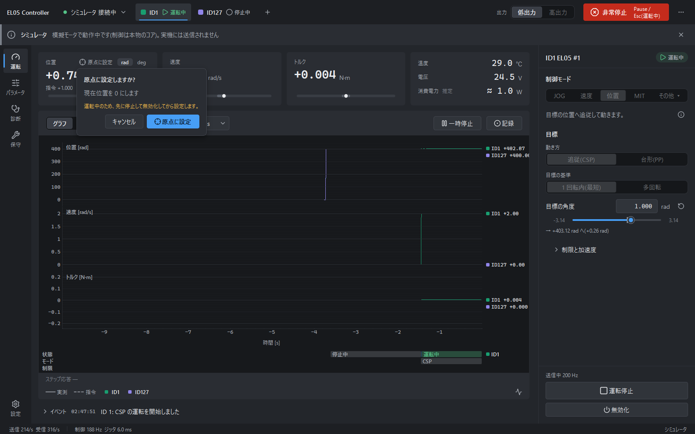

### 3.5 MIT のトルクは上限を超えるか(limit_torque)

MIT では、Kp と Kd による力はモータの中で計算されます。PC 側の安全制限が直接制限できるのは、PC から送る Kp・Kd・追加のトルクの値までです。
そこで安全制限は、出力段階のトルク上限(低出力で 0.5 N·m)を、モータの `limit_torque`(0x700B)にも書き込みます。
この制限がモータ内部の Kp・Kd の出力にも働くかどうかは、実機で確かめるまで分かりませんでした。

実機で手で押してみると、持続するトルクは `limit_torque` で頭打ちになりました(上限 0.5 で約 0.49 N·m、0.2 で約 0.18 N·m)。
ただし、手で急に動かした瞬間の数 ms だけは、上限の 1.5–2 倍が出ました(上限 0.5 で最大 0.76 N·m、0.2 で最大 0.42 N·m)。
低出力でも、MIT でハンドルを勢いよく叩くような操作は避けてください。

### 3.6 試験の前に確かめること

- 試験中は、モータの可動範囲に手や物を置かないでください。キーボードが近いと、思わぬ向きに回ったハンドルが当たります。
- 初回は低速(1 rad/s 以下)・小さな角度から始めます。
- 固定していないモータは、低出力だけで使います。トルクの反力で、筐体ごと回ることがあるためです。
- 故障が出たら、原因を取り除いてから [故障をリセット] を押します(§7.1)。

---

## 4. モータを回すには(モードごとの使い方)

どのモードも、次の順に操作します。

1. ヘッダーのモータチップで、操作対象を選びます。
2. 停止中(無効)のうちに、インスペクタで制御モードを選びます。
3. 目標を設定します。
4. [有効化] → [運転開始]。目標は運転中でも変えられ、すぐ反映されます。
5. [運転停止] → [無効化]。

下の「最初の値」は、実機で動作を確認した値です(24 V、無負荷に近い状態、低出力)。初回は、この値から始めてください。

| モード | 最初の値 |
|---|---|
| JOG | 速度 1 rad/s |
| 速度 | 0.5 rad/s |
| 位置(CSP) | 相対 ±1 rad、速度制限 1 rad/s |
| MIT ダンパ | Kp 0、Kd 0.15 |
| MIT ばね | Kp 2、Kd 0.1 |
| 電流 | 0.2 A、数秒だけ |

### 4.1 JOG(押している間だけ回す)

JOG は、ボタンを押している間だけ回り、離すと止まるモードです。

1. モード `JOG` を選び、速度(既定 1 rad/s)を決めます。
2. [有効化] を押します。
3. [◀ 逆転] / [正転 ▶] を押し続けます。インスペクタにフォーカスがあるときは、キーボードの ← / → の長押しでも動かせます。
4. ボタンを離す、ポインタがボタンから外れる、ウィンドウがフォーカスを失う、通信が途絶える、のどれでも即座に止まります。

正転は「出力面側から見て時計回り」です。

### 4.2 速度

速度モードは、指定した速度で回り続けるモードです。

1. モード `速度` を選び、目標の速度を `0.5` rad/s にします(低出力では ±5 rad/s の範囲)。
2. 「▸ 制限と加速度」で、電流制限(既定 1 A)と加速度(既定 20 rad/s²)を確認します。
3. [有効化] → [運転開始]。速度は運転中にも変えられます。
4. [運転停止](速度 0 になります)→ [無効化]。

低出力で 5 rad/s を超える値を入れると、上限の 5 rad/s に制限され、欄にその旨が表示されます。

### 4.3 位置(CSP / PP)

位置モードは、目標の位置へ動くモードです。

| 項目 | 内容 |
|---|---|
| 動き方 | 追従(CSP): 速度制限の範囲で目標へ追従します(既定)。台形(PP): 台形の速度計画(最大速度・加速度)で動き、止まります |
| 目標の基準 | 1 回転内(最短)(既定): 目標を −π〜π(−180°〜180°)の角度で指定します。アプリが、いまの位置から最短で動く多回転の位置へ変換します。多回転: 多回転の位置(±4π)をそのまま指定します |
| 速度制限(CSP) | 既定 2 rad/s。最初は 1 rad/s にします |

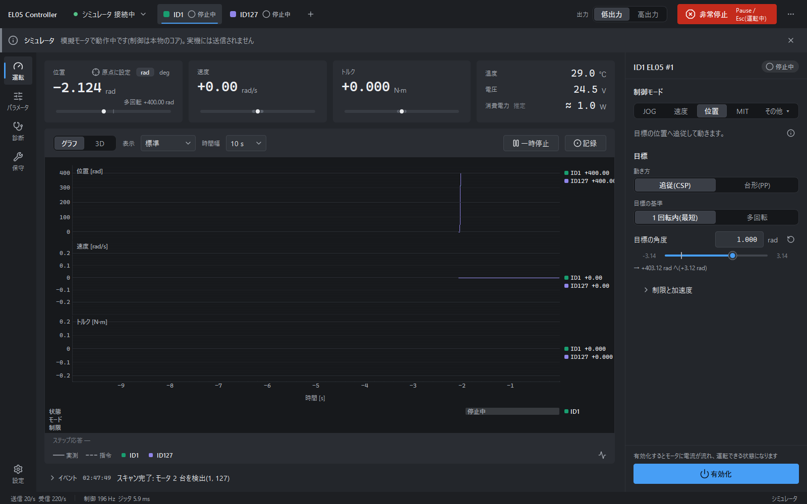

手順:

1. モード `位置` を選び、動き方を `追従(CSP)`、目標の基準を `1 回転内(最短)` にします。
2. 目標の角度を、たとえば `1.0` rad にします。欄の下に、移動先と移動量が出ます。
3. [有効化] → [運転開始]。角度は運転中も変えられます(目標の基準は運転中には切り替えられません)。
4. [運転停止](現在位置を保持)→ [無効化]。

有効化の直後は、位置の目標がいまの位置に設定されるので、モータが急に動くことはありません。

実機では、相対 ±1 rad(速度制限 1 rad/s)で、最終位置の誤差 0.0001 rad、行き過ぎなし、±2 % に入るまで約 1 秒でした。
このとき速度は最大 1.22 rad/s と、制限を約 2 割上回りました。モータ内部の速度ループの動きによるものです。

### 4.4 MIT(ばねとダンパのようにふるまう)

MIT は、位置と速度の差に応じたトルクを出すモードで、手で回したときの手応えを確かめるのに使います。出力は次の式で決まります。

```
トルク = Kp × (目標位置 − 現在位置) + Kd × (目標速度 − 現在速度) + 追加のトルク
```

Kp はばねの強さ、Kd はダンパ(粘り気)の強さです。

先頭のプリセットのボタンで、値をまとめて設定できます。押しただけでは動きません(有効化と運転開始が必要です)。

| プリセット | 設定 | 手応え |
|---|---|---|
| 脱力 | Kp 0、Kd 0 | 手で自由に回せます(モータの摩擦は残ります) |
| ダンパ | Kp 0、Kd 0.15 | 回すと粘り気があり、速く回すほど抵抗が強くなります |
| 抵抗ゼロ | Kp 0、Kd 0、摩擦補償 0.03 N·m | 軸の摩擦を PC 側で打ち消し、軽く回せるようにします |
| ばね | Kp 2、Kd 0.1、位置 0 rad | 原点(0 rad)へ引き戻されます |
| その場で保持 | Kp 10、Kd 0.5、位置 = 現在位置 | いまの位置に留まります |

手順(ダンパの例):

1. モード `MIT` を選び、プリセット `ダンパ` を押します。
2. [有効化] → [運転開始]。
3. モータの軸(ハンドル)を、手でゆっくり、次に速く回します。速く回すほど重く感じます。
4. [運転停止] → [無効化]。

実機での確認結果:

| 試験 | 結果 |
|---|---|
| ダンパ(Kd 0.15、低出力) | 0.2–3.3 rad/s で、速度に比例した抵抗(傾き −0.164 N·m·s/rad)。3.3 rad/s を超えると 0.5 N·m で頭打ち。体感するには Kd 0.1–0.2 が分かりやすい |
| ばね(Kp 2、Kd 0.1、低出力) | 位置誤差 0.25 rad までは傾き −2.0〜−2.2 N·m/rad。それ以上は約 0.49 N·m で頭打ち。離すと誤差 0.018 rad で止まり、振動なし |
| ばね(高出力、固定、Kp 3、Kd 0.15) | 位置誤差 0.72 rad まで直線的に増え、2.2 N·m に達した。離すと 0.001 rad で停止。振動・異音・発熱なし |

低出力では、Kp を大きくしても 0.5 N·m で頭打ちになります。位置誤差が小さいうちにトルクが上限へ達し、それ以上は強くならないためです。

**負の Kd と摩擦補償**(PC 側の項)

- Kd の欄には、出力段階の範囲で負の値も入れられます(低出力で −0.05 まで)。負の Kd は、速度に応じて動きを助ける向きのトルクになります。
- 「▸ 制限と加速度」の中に、摩擦補償(低出力で 0.1 N·m まで)があります。軸の摩擦を打ち消す向きの補助トルクです。
- どちらも PC 側で計算し、速度が上がりすぎると暴走ガード(§3.3)が制動します。「抵抗ゼロ」の手応えには個体差があり、実機での評価はまだ限られています。

**その他の設定**

- 「目標速度」と「フィードフォワードトルク」は、通常は 0 のままにします。
- 「▸ 制限と加速度」の「連続送信」をオフにすると、運転開始で指令を 1 回だけ送ります。
- MIT の目標位置は、位置モードのような「1 回転内」の指定ではなく、多回転の値です。±4π 付近では Kp が自動で 0 になります(§3.4)。

### 4.5 電流

電流モードは、指定した電流(Iq)の指令を直接送るモードです。

1. 「その他 ▾」→ `電流(トルク)` を選びます。
2. 目標の電流を、まず `0.2` A 程度にします。
3. [有効化] → [運転開始]。無負荷だとすぐに速く回り出すので、軸を軽くつかんでおきます。
4. [運転停止] → [無効化]。

注意:

- 加速度は電流の指令にほぼ比例します(ベンチの円盤付きで、0.5 A → 約 28 rad/s²、1.0 A → 約 58 rad/s²)。
- 電流モードではモータ側の速度制限が働かないので、暴走ガード(§3.3)が速度を抑えます。
- この EL05 では、Iq の指令 1 A に対して実際に流れる電流は約 0.1 A です。指令値からトルクを計算しないでください(§12.7)。

### 4.6 試験信号(正弦波 / ステップ / 三角波)

試験信号は、目標の量を自動で時間変化させ、その応答をグラフで見るためのモードです。

1. 「その他 ▾」→ `試験信号` を選びます。
2. 対象量(位置 / 速度 / 電流 / トルク)を選びます。位置は現在位置からの相対、トルクは MIT のフィードフォワードです。
3. 波形 `[正弦 | ステップ]` を選び、値を入れます。

   | 波形 | 設定 | 既定値 |
   |---|---|---|
   | 正弦 | 振幅、周波数 0.01–20 Hz、オフセット | 振幅 0.5、1 Hz |
   | ステップ | Low 値、High 値、周期(Low と High を交互に出力) | 0 と 0.5、周期 2 s |

4. [有効化] → [運転開始] → [運転停止] → [無効化]。

最初は、対象量 `速度`、振幅 0.5 rad/s、周波数 1 Hz から始めます。
ステップを動かすと、グラフの下に「立上り時間・オーバーシュート・整定時間」が出ます(§5.5)。

三角波は、同梱のサンプルプラグイン(§11.1)が足すモードです。「その他 ▾」の中に `三角波` が出ます。使い方は試験信号と同じで、対象量・振幅・周波数を指定します。

### 4.7 2台連動(バイラテラル)

2台連動は、一方を手で動かすと、もう一方が同じ位置へ動くモードです。MIT の位置・速度の指令を、2 台が互いに送り合います。
モータが 2 台以上接続されているときだけ、「その他 ▾」に `2台連動` が出ます。

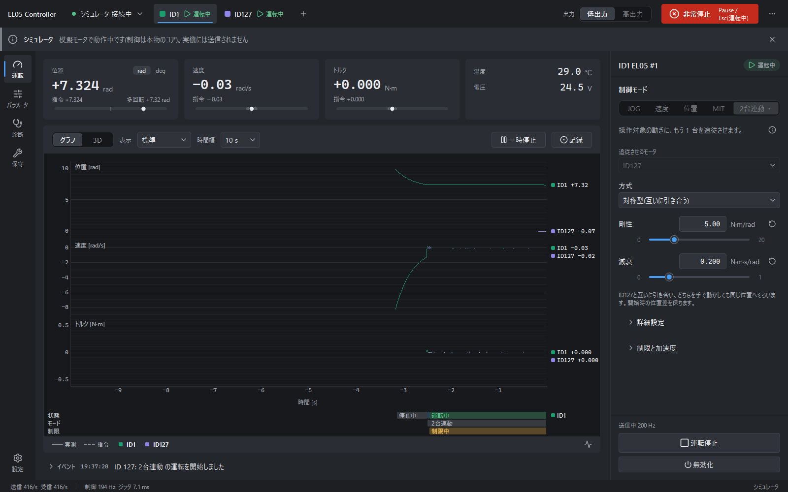

| 設定 | 内容 |
|---|---|
| 追従させるモータ | 連動させる相手 |
| 方式 | 対称型: 互いに引き合い、どちらを動かしても同じ位置にそろいます。マスタ・スレーブ: 操作対象は力を抜き、手で動かすと相手が追従します |
| 剛性(既定 5 N·m/rad) | 引き合う強さ(MIT の Kp) |
| 減衰(既定 0.2 N·m·s/rad) | 動きの粘り気(Kd) |
| 詳細設定 | 位置差の扱い(開始時の位置差を保つ / 位置差を 0 へ近づける)、位置差の収束速度、力の順送り係数、リーダー側の減衰 |

開始時の位置差は、既定では保たれるので、開始した瞬間に相手を急に引き寄せることはありません。
低出力では、最悪の場合のトルクが 0.5 N·m に制限されます。±4π 付近では 2 台とも Kp が 0 になり、減衰だけの結合になります(§3.4)。

> ベンチのモータは 1 台なので、実機 2 台での確認はまだ行っていません。最初は、低出力・小さな剛性から試してください。

---

## 5. グラフの道具

グラフは、運転ページのモニタにあります。

### 5.1 表示・時間幅・一時停止

| 操作 | 内容 |
|---|---|
| 表示プリセット | `標準`(位置・速度・トルク)/ `MIT 解析`(位置・トルク)/ `温度・電圧` / `すべて`(電流と推定電力の段も出る)/ `FFT` |
| 時間幅 | 2 / 5 / 10 / 30 / 60 / 120 秒(既定 10 秒) |
| 一時停止 | グラフを止めます(グラフを選んで Space でも可)。止めている間は、マウスを重ねると縦のカーソルが全段で同期して値が出ます。[再開] で戻ります |
| 凡例 | `── 実測`、`- - 指令`、モータの ■(クリックで、そのモータの表示 / 非表示) |

各段の右端には、最新の値が出ます。

### 5.2 トリガで単発取得するには

トリガは、条件が成立した瞬間の前後を残してグラフを止める機能です(1 回だけ)。

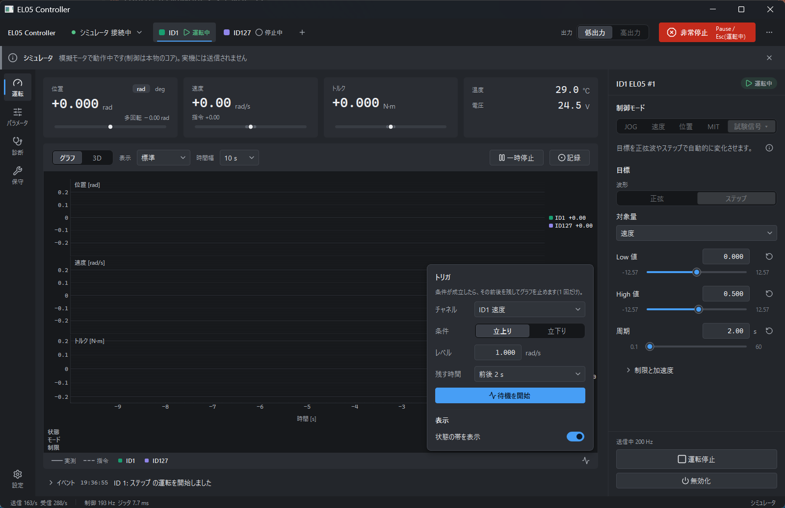

1. 凡例の行の右端にある [解析] ボタン(波形のアイコン)を押します。
2. 「トリガ」で、チャネル(例: `ID1 速度`)、条件(立上り / 立下り)、レベル、残す時間(前後 1 / 2 / 5 / 10 秒)を設定します。
3. [待機を開始] を押します。ボタンの表示が「トリガ待機中」になります。
4. 指定したチャネルがレベルを横切ると、グラフが止まり、「トリガ成立」と表示されます。トリガの位置に印が付きます。
5. [再開] で解除します。待機をやめるときは [待機を解除] を押します。

ステップ応答を撮るときは、試験信号のステップと、速度の立上りのトリガを組み合わせます。

### 5.3 2 点の差を測るには(Δ カーソル)

一時停止中に、グラフ上を 2 回クリックします。

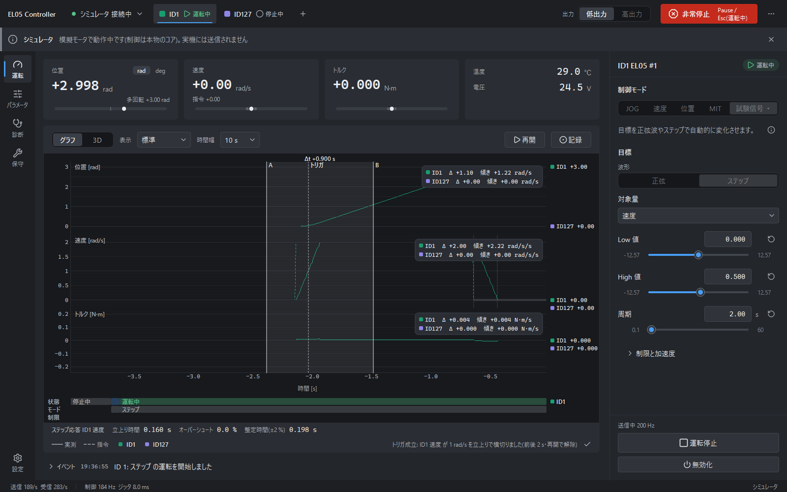

- 2 点 A・B の間の Δt と、各チャネルの Δ値・傾き(単位/秒)が出ます。
- 右クリックで解除します。

### 5.4 FFT

表示プリセットを `FFT` にすると、ツールバーに「対象」が出ます。そこで、調べたい量(例: `ID1 速度`)を選びます。
窓関数は Hann で、ピークの周波数と振幅が右上に出ます。
データが足りないと表示されたときは、時間幅を長くします。

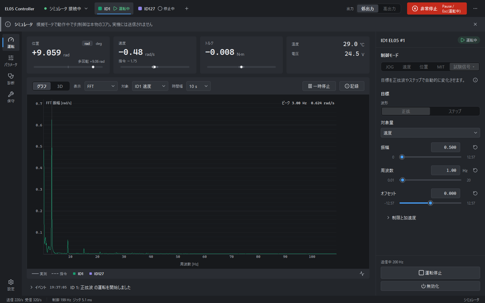

### 5.5 ステップ応答の指標

試験信号の「ステップ」を実行すると、グラフの下の 1 行に、次の値が自動で出ます。

| 指標 | 意味 |
|---|---|
| 立上り時間 | 最終値の 10 % から 90 % に達するまでの時間 |
| オーバーシュート | 最終値からの行き過ぎ量(%) |
| 整定時間(±2 %) | 最終値の ±2 % に入って、出なくなるまでの時間 |

結果がないときは、淡く「ステップ応答 —」と出ます。

### 5.6 状態の帯

グラフの下に、時間の流れに沿った 3 段の帯が出ます。

| 段 | 内容 |
|---|---|
| 状態 | 停止中 / 運転中 / 故障など |
| モード | 実行していたモード(速度、ステップ、2台連動 など) |
| 制限 | 出力段階の上限や暴走ガードで、指令が制限された時間帯(琥珀色) |

[解析] のポップオーバーの「状態の帯を表示」で、表示を切り替えられます。

### 5.7 CSV に記録する

1. [⏺ 記録](または `Ctrl+R`)で記録を始めます。記録中は「● 記録中 00:12」と出ます。
2. もう一度押す(または `Ctrl+R`)と記録を止め、ファイルに保存します。「記録を保存しました: record_….csv」と出ます。

| 項目 | 内容 |
|---|---|
| 保存先 | プロジェクトの `user_data/records/`(git の管理外) |
| ファイル名 | `record_YYYYMMDD_HHMMSS.csv`(シーケンスの記録は `seq_<名前>_<日時>.csv`) |
| 記録される量 | 位置(多回転)、速度、トルク、温度、電圧、位置・速度・トルク・電流の指令、電流 など(全レート) |

ファイルの形式:

```
# edulite05 telemetry recording
# profile: RobStride EduLite 05
# started: 2026-10-03T01:57:26+09:00
# tier: high
# clock_t0: 1283251.6103741
# channel: m127.vel unit=rad/s motor=127 kind=feedback label=m127 velocity
# channel: m127.cmd.vel unit=rad/s motor=127 kind=command label=m127 velocity command
time_s,m127.pos_multi,m127.vel,m127.tq,m127.temp,m127.vbus,m127.cmd.pos,m127.cmd.vel,m127.cmd.tq
0.002445,,,,,,,0,
0.009091,,-0.000762951095,,,,,0,
```

- `# ` で始まる行はメタデータです(プロファイル、開始日時、出力段階、各チャネルの単位とモータ ID)。
- 続く 1 行が列見出しで、`time_s` は記録開始からの秒数です。
- 1 サンプルごとに 1 行です。その行で更新されなかった量は直前の値を保ち、まだ一度も受信していない量は空欄です。
- pandas なら `pd.read_csv(path, comment="#")` で読めます。

---

## 6. パラメータページ

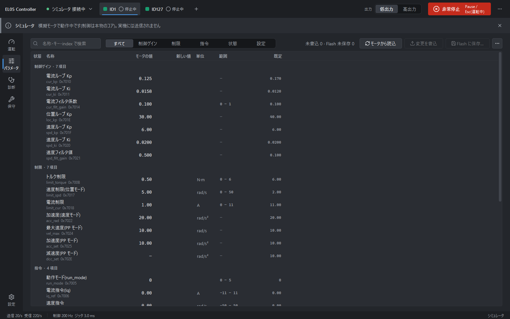

パラメータページでは、モータ内部のパラメータ(0x70xx)を一覧で読み書きします。グループは「制御ゲイン / 制限 / 指令 / 状態 / 設定」です。

### 6.1 パラメータを読むには

ページを開くと、接続中のモータから自動で読み込みます。[モータから読込] で読み直せます。
検索欄(名称・キー・index)と、グループのタブで絞り込めます。

- 「モータの値」の列が、いまモータにある値です。
- 「状態」グループは読み取り専用です(母線電圧、多回転位置など)。
- この個体では、28 項目のうち 3 項目(`alveolous_open`、`iq_test`、`dcc_set`)が読み出せず、表では `—` になります。読み出しの要求にモータが失敗を返すためで、故障ではありません(ファームウェアの仕様と考えられます)。

### 6.2 パラメータを書き込むには

書込は、モータが停止中(無効)のときだけできます。有効・運転中・故障中・未接続のときはボタンが押せず、理由が出ます。

1. 書きたい項目の「新しい値」の欄に値を入力します。Enter で確定、↑ / ↓ で増減(Shift で 10 倍)。範囲外の値には赤枠と理由が出ます。
2. 左の状態の列に ✎(編集中)が付き、上に「未書込 n」と出ます。
3. [変更を書込] を押すと、モータへ書き込みます。書いた項目は「変更済み(電源を切ると工場値に戻ります)」(●)になります。

書き込んだ値は、電源を切ると工場値に戻ります。[モータに保存(type 22)…] を押しても残りません(§6.4)。

`⋯` メニュー:

| 項目 | 内容 |
|---|---|
| ファイルへ書き出し… | いまの値をファイルに保存します |
| ファイルから読み込み… | 差分を確認してから、「新しい値」に取り込みます(モータへは [変更を書込] を押すまで送りません) |
| 既定値に戻す… | 既定値を「新しい値」に入れます |

「指令」と「状態」のグループは、取り込みと既定値の対象から外してあります。読み込んだ値でモータが意図せず動くのを避けるためです。

### 6.3 書き込みを拒否する項目

運転に関わる次の項目は、パラメータページ(と保守の操作)から書こうとしても拒否され、ログにエラーが出ます。

| キー | 理由 |
|---|---|
| `run_mode`、`iq_ref`、`spd_ref`、`loc_ref` | 運転の目標です。運転ページのモードと目標を通してだけ、安全制限つきで書かれます |
| `limit_torque`、`limit_cur`、`limit_spd` | 出力段階の上限をモータ側にも書いた値(二重の制限)です。出力段階を切り替えたときに、アプリが書き込みます |

CLI の `param set` も、これらの項目を拒否します(§10.2)。

### 6.4 書いた値は電源を切っても残るか(type 22)

[モータに保存(type 22)…] は、公式ツールと同じ保存の要求(type 22)を送るボタンです。
名前からは、書いた値が電源を切っても残りそうに見えます。
しかし実機で試すと、0x70xx の運転パラメータ(ゲイン、EPScan_time など)は、type 22 を送っても保存されませんでした。EPScan_time を 2 にして保存し、電源を入れ直すと 0 に戻っています(実測 HW-6)。
メーカーの資料が type 22 の保存対象として挙げているのは 0x20xx と 0x702A / 0x702B だけで、この結果と合っています。ただし 0x20xx を読み書きできるかは、まだ確かめていません。

運転への影響はありません。アプリは有効化のたびに、通信タイムアウト(canTimeout)と各制限値を、運転用の値で書き直すからです。

なお、type 22 に対してモータは、type 2 ではなく type 0(UID)で応答します。アプリはどちらの応答も受け付けます。

---

## 7. 診断ページ

診断ページの上のセグメント `[故障] [イベントログ] [CAN フレーム] [通信統計]` で、表示を切り替えます。

### 7.1 故障

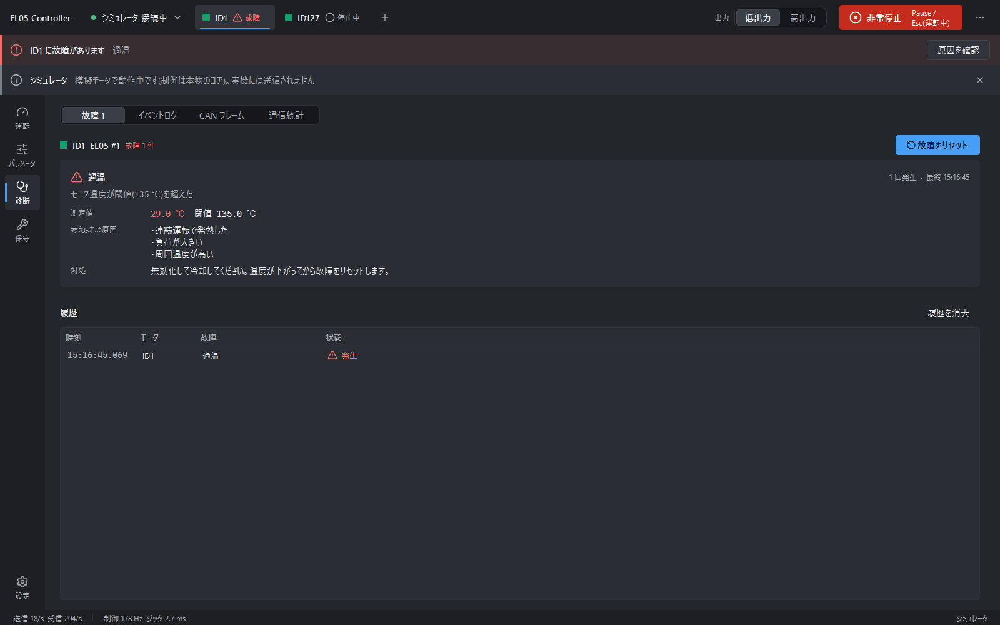

- 故障がなければ「故障はありません」と 1 行だけ出ます。
- 故障があると、モータごとのカードに、名称・説明・測定値と閾値・考えられる原因・対処が出ます。そのモータは無効化されています。
- 原因を取り除いてから [故障をリセット] を押します。
- 下の「履歴」に、発生と解消の時刻が残ります([履歴を消去] で消せます)。

故障の一覧は §12.5 にあります。

### 7.2 イベントログ

イベントログは、アプリの動作の記録です(接続、有効化、運転開始、制限、再送、エラーなど)。

- 「レベル」で、デバッグ / 情報 / 警告 / エラー以上に絞り込みます。
- 検索欄で絞り込めます。
- [クリア]、[書き出し…] ができます。

運転ページのイベント行をクリックしても、ここへ移ります。

### 7.3 CAN フレーム

アダプタを流れる CAN フレームを、時刻・方向(TX / RX)・CAN ID・type・データ・デコード結果で表示します。通信の不具合を調べるときに使います(§12.2)。

- [一時停止] / [再開]、type・モータ・方向のフィルタ、自動スクロール、[クリア]。
- 表示が追いつかないときは、毎秒 200 件までに間引きます。間引くのは表示だけで、通信には影響しません。間引いた累計は「通信統計」に出ます。

### 7.4 通信統計

| 項目 | 意味 |
|---|---|
| 送信 / 受信 | フレーム/秒 |
| 制御周期 / ジッタ | 制御ループの周期(目標 200 Hz)と、周期のばらつき |
| パース失敗 | 解釈できなかった受信フレームの数 |
| タイムアウト | 応答が返らなかった要求の数 |
| 再送(冪等要求) | 応答が返らず再送した数。数件なら正常です(§12.2) |
| フレーム表示の間引き | §7.3 で間引いた表示の累計 |

---

## 8. 保守ページ

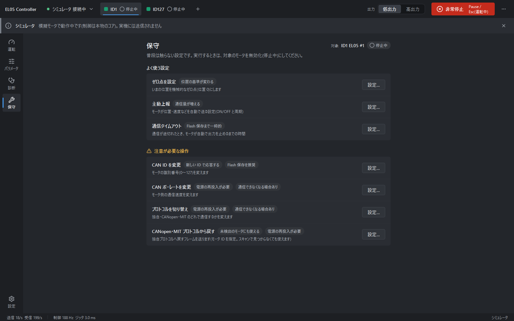

保守ページには、普段は触らない設定が「よく使う設定」と「注意が必要な操作」に分けて並んでいます。
各行のタグは、その操作の影響(「電源の再投入が必要」など)を示します。
[設定…] でダイアログが開くので、内容と前提条件を確認し、動詞のボタン(例: 「ID を 2 に変更」)で実行します。

実行できるのは、対象のモータが停止中(無効)のときだけです(押せないときは理由が出ます)。
「注意が必要な操作」では、誤操作を防ぐため、対象のモータ ID を入力して確定します。

### 8.1 よく使う設定

| 項目 | 内容 |
|---|---|
| ゼロ点を設定 | いまの位置を機械的なゼロ点(位置 0)にします。運転ページの [⊕ 原点に設定] と同じ操作で、位置の表示と指令の基準が変わります。ゼロ点は、保存しなくても電源を入れ直したあとに残ることを実機で確認しました。EL05 は CSP と MIT のモードでだけゼロ点の設定を受け付けるので、アプリが設定の前にモードを自動で切り替えます。旧ファームでは、設定の直後に軸が動くことがあります |
| 主動上報 | モータが位置・速度などを自動で送る設定(ON / OFF と周期)。周期 = 10 + 5 × N ms です(N = 0 → 10 ms、N = 1 → 15 ms。メーカーのマニュアルにある「1 = 10 ms」は実機の挙動と違います)。アプリは運転中に自動でオフにするので、普段は触りません |
| 通信タイムアウト | 通信が一定時間途切れたとき、モータが自動で出力を止めるまでの時間。「無効」(0)にもできます。書いた値は電源を切るまで有効です(§6.4)。アプリは有効化のたびに、この値を運転用の値で書き直します。個体によっては、すでに有効(例: 約 0.25 s)になっています |

### 8.2 注意が必要な操作

| 項目 | 内容と警告 |
|---|---|
| CAN ID を変更 | モータの ID(0〜127)を変えます。変更はすぐに有効になります。同じバスに同じ ID があると衝突します。変更後は再スキャンして確認します。電源を入れ直したあとも残るかは、実機で未確認です |
| CAN ボーレートを変更 | モータ側の通信速度を変えます。電源の再投入が必要です。このアプリのアダプタは 1 Mbps 固定なので、1 Mbps 以外にすると、再投入後はこのツールからつながりません。MIT プロトコルのモータでは変更できません |
| プロトコルを切り替え | 独自 / CANopen / MIT の切替。電源の再投入が必要です。CANopen や MIT にすると、このツールからは通信できなくなります |
| CANopen・MIT プロトコルから戻す | 独自プロトコルへ戻すフレームを送ります。スキャンで見つからないモータにも使えます(モータ ID と、いまのプロトコルを指定)。電源の再投入が必要です。公式 USB-CAN の標準フレームの表し方が未確認のため、この経路で戻せるかも未確認で、結果は「未検証」と表示されることがあります |

> プロトコルを CANopen / MIT に切り替えると、元に戻せなくなる恐れがあります。戻す操作が公式 USB-CAN 経由で働くかを確かめていないためです。何をしているか分かっていないときは、実行しないでください。

---

## 9. スクリプトページ(コンソールとシーケンス)

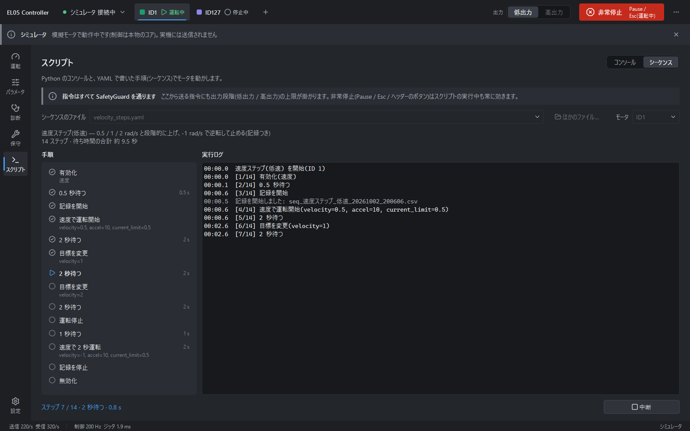

スクリプトページでは、Python のコードや YAML の手順でモータを動かせます。任意の Python を実行できる機能なので、設定ページで無効にもできます(§11.1)。
ページの上部には「指令はすべて SafetyGuard を通ります」と常に表示されます。ここから出す指令にも出力段階の上限がかかり、非常停止は実行中も使えます。

上のセグメントで `[コンソール | シーケンス]` を切り替えます。

### 9.1 コンソール(Python)

| 操作 | キー |
|---|---|
| 実行 | Enter |
| 改行 | Shift+Enter |
| 履歴 | ↑ / ↓(最大 50 件を保存) |

使える名前: `service`(モータ制御の窓口)、`telemetry`、`session`、`controllers`、`params`、`make(名前, **パラメータ)`、`ids()`、`sleep(秒)`、`wait(future)`、`run_sequence(path)`、`RunMode`、`PowerTier`。

例(速度 0.5 rad/s で 2 秒):

```python
ids()
wait(service.enable(ids()[0], RunMode.VELOCITY))
service.start(ids()[0], make("velocity", velocity=0.5))
sleep(2); service.stop_motion(ids())
wait(service.disable(ids()[0]))
```

- 待つときは `time.sleep` ではなく `sleep()` / `wait()` を使います。`sleep()` / `wait()` は中断の操作で途中から戻りますが、`time.sleep` は指定の時間が過ぎるまで戻りません。
- 実行中は、主ボタンが [中断] に変わります。中断すると、スクリプトを止め、全モータを運転停止にします(有効のまま保持)。
- 実行はワーカースレッドで行うので、画面は止まりません。

### 9.2 シーケンス(YAML の手順)

シーケンスは、YAML ファイルに書いた手順を自動で実行する機能です。ファイルは `sequences/*.yaml` に置きます(「ほかのファイル…」で任意の場所も選べます)。

最小の例です。`sequences/` に、たとえば `slow_round_trip.yaml` という名前で保存します。

```yaml
name: ゆっくり往復
motor: 127
steps:
  - enable: velocity          # 有効化(速度モード)
  - record: start             # CSV の記録を開始
  - run:                      # 運転して、秒数だけ待ち、運転停止
      controller: velocity
      params: {velocity: 0.5}
      seconds: 3
  - run:
      controller: velocity
      params: {velocity: -0.5}
      seconds: 3
  - record: stop
  - disable                   # 無効化
```

使える手順:

| 手順 | 内容 |
|---|---|
| `enable: <モード>` | 有効化。`velocity` / `current` / `csp` / `pp` / `mit` |
| `start: {controller, params}` | 運転開始(待たない) |
| `run: {controller, params, seconds}` | 開始して、秒数だけ待ち、運転停止(秒数は 0 より大きく 3600 以下) |
| `set_params: {…}` | 運転中の目標を変える |
| `wait: 秒` | 待つ(0 以上 3600 以下) |
| `stop` | 運転停止(有効のまま保持) |
| `record: start` / `record: stop` | CSV 記録の開始 / 停止(保存先は `user_data/records/`) |
| `log: 文字列` | 実行ログにメッセージを出す |
| `disable` | 無効化 |

- 実行前に、文法・キー名・パラメータの名前と範囲・手順の順序をすべて検査します。問題があれば `ファイル名:行 N: 内容` の形で全件を示し、実行しません(モータには何も送りません)。
- 出力段階の上限を超える値は「注意」として示します。実行はでき、安全制限が上限に制限します。
- 対象は 1 台のモータだけです。2台連動は書けません。
- 同梱のサンプル `sequences/velocity_steps.yaml` は、0.5 → 1 → 2 rad/s と上げ、−1 rad/s で逆転して止めます(記録つき)。

実行するには:

1. ファイルとモータを選びます。
2. 検証結果と手順の一覧を確認します。一覧の印は、進行に合わせて ○ → ▶ → ✓ と変わります。
3. [シーケンスを実行] を押します。実行中は [中断] で止められます。

ボタンが押せないときは、理由がツールチップに出ます(未接続、非常停止中、高出力、モータが停止中でない、ファイルに問題がある など)。

実行の約束:

- 低出力のときだけ実行します。高出力のときは開始しません(§3.1)。
- 開始前の確認(接続している・非常停止がない・低出力・モータが停止中)に通らなければ、モータへ何も送りません。
- 完了・中断・エラー・非常停止のどれで終わっても、記録を止め、運転停止 → 減速を待つ → 無効化の順で終えます。

CLI からも実行できます(§10.3)。

```
uv run --frozen python -m edulite05.cli run-sequence sequences/velocity_steps.yaml --sim --id 127 --yes
```

---

## 10. CLI(コマンドライン)

CLI を使うと、GUI を開かずに、読み出しと簡単な運転ができます。実機の確認や、ほかのスクリプトからの利用に向いています。

```
uv run --frozen python -m edulite05.cli <コマンド> [ID] [オプション]
```

`<コマンド> --help` で詳細が出ます。

### 10.1 つなぎ方(全コマンド共通)

| オプション | 内容 |
|---|---|
| `--port COM7` | 実機(公式 USB-CAN のシリアルポート) |
| `--sim [N]` | シミュレータ N 台(既定 1 台。ID は 127, 1, 2, …)。ID は `--sim` より先に書きます(`info 127 --sim`) |
| `--host 0xFD` | ホスト ID(通常は変更不要) |
| `--log PATH` | 全 TX/RX フレームを candump 形式で記録します。パスはローカルディスクにします(§12.2) |
| `--timeout 0.2` | 要求ごとの応答待ちの秒数 |

- `--port` か `--sim` のどちらか一方が必要です。
- GUI と CLI は、同じ COM ポートを同時には使えません。
- 終了コード: 成功 0 / 応答なし(タイムアウト)2 / その他のエラー 1。

### 10.2 読み出し・設定のコマンド

| コマンド | 内容 | 例 |
|---|---|---|
| `ports` | シリアルポートの一覧(★ = 公式 USB-CAN) | `ports` |
| `scan` | モータを探して UID を表示(`--ids` で範囲。既定 1–127) | `scan --port COM7` |
| `info ID` | UID・バージョン・モード・動作モード・故障・位置・温度・電圧 | `info 127 --port COM7` |
| `params ID` | 全パラメータを表示(`--group`、`--json`) | `params 127 --port COM7 --group 制限` |
| `param get ID KEY` | パラメータを 1 件読む(キーまたは index) | `param get 127 limit_spd --port COM7` |
| `param set ID KEY VALUE` | パラメータを 1 件書き、読み戻して確認する(`--save` で type 22 の保存も送るが、0x70xx は電源を切ると工場値に戻る。§6.4) | `param set 127 acc_rad 10 --port COM7` |
| `monitor ID` | 主動上報をオンにして 1 行で表示(有効化はしない。`--rate`、`--seconds`) | `monitor 127 --port COM7 --seconds 10` |
| `enable ID --yes` | 有効化(有効のまま終了する。止めるには `disable`) | `enable 127 --port COM7 --yes` |
| `disable ID` | 無効化(`--clear-fault` で故障もクリア) | `disable 127 --port COM7` |
| `estop` | 範囲内の全 ID へ停止(type 4)を一括送信(`--ids`、既定 1–127。スキャンせず即時) | `estop --port COM7` |
| `raw ID TYPE DATA2 HEX` | 生フレームの送信(デバッグ用。`--i-know-what-im-doing` が必要。type 1 は不可) | (通常は使いません) |

`param set` は、次の値を拒否します。

- 読み取り専用の項目と、「状態」グループの項目。
- 運転系の項目(`run_mode` / `iq_ref` / `spd_ref` / `loc_ref` / `limit_torque` / `limit_cur` / `limit_spd`)と `iq_test`。書けると出力段階の制限を迂回できてしまうためです。運転は運動のコマンドで行い、制限値は出力段階からアプリが書きます(§6.3)。
- 範囲外の値。

### 10.3 運動のコマンド(`--yes` が必要、低出力のみ)

| コマンド | 内容 | 例 |
|---|---|---|
| `jog ID` | 一定速度で回す(`--speed`、`--reverse`、`--seconds`。既定 1 rad/s、2 秒) | `jog 127 --port COM7 --speed 1 --seconds 1.5 --yes` |
| `velocity ID` | 速度モード(`--speed`、`--accel`、`--current-limit`。既定 1 rad/s、3 秒) | `velocity 127 --port COM7 --speed 0.5 --seconds 5 --yes` |
| `current ID` | 電流モード(`--iq` が必須。既定 2 秒) | `current 127 --port COM7 --iq 0.2 --seconds 1 --yes` |
| `mit ID` | MIT(`--kp`、`--kd`、`--position`、`--velocity`、`--torque`、`--damping`。既定 3 秒)。`--damping` は Kp 0 の粘性ダンパ | `mit 127 --port COM7 --damping --kd 0.15 --seconds 10 --yes` |
| `csp ID` | 位置モード(`--position` が必須、`--relative`、`--speed-limit`。既定 5 秒、1 rad/s) | `csp 127 --port COM7 --position 1 --relative --yes` |
| `sine ID` | 正弦波の試験信号(`--target`、`--amplitude`、`--frequency`、`--offset`。既定 6 秒) | `sine 127 --port COM7 --target velocity --amplitude 0.5 --frequency 1 --yes` |
| `run-sequence FILE` | YAML のシーケンスを実行(`--id`、`--records-dir`) | `run-sequence sequences/velocity_steps.yaml --port COM7 --id 127 --yes` |

### 10.4 `--yes` と安全の約束

- モータを有効化するコマンド(`enable`、運動のコマンド、`run-sequence`)は、すべて `--yes` が必要です。`--yes` は「モータが動くことを了承する」という意味で、無いと何も送らずに終了します(終了コード 1)。
- `disable`、`estop`、読み出し系のコマンドには `--yes` は要りません。
- 運動のコマンドは低出力だけで動きます(`--tier high` は受け付けません)。高出力は GUI でだけ使えます(§3.1)。
- 運動のコマンドは、正常終了・Ctrl+C・エラーのどれで終わっても、運転停止 → 減速を待つ → 無効化を行います。Ctrl+C で途中で中断できます。
- `enable` だけは、有効のまま終了します。必ず `disable` で止めてください。

---

## 11. 設定ページ

設定ページは、ナビの最下部の「設定」です。

| 項目 | 内容 |
|---|---|
| テーマ | ダーク / ライト / システム(OS の配色に合わせる) |
| 角度の表示単位 | rad / deg(表示と入力の単位。内部の計算は常に rad) |
| グラフの既定 | 開いたときの時間幅と表示プリセット |
| ホスト ID | アダプタ側の CAN ID。通常は 0xFD のまま(次の接続から有効) |
| 言語 | 日本語 / English。変更は次回の起動から反映されます(`--lang` や環境変数 `EDULITE05_LANG` が優先。一時的に変えるだけなら `run.bat --lang en`) |
| プラグイン | 一覧と有効 / 無効の切替(§11.1) |
| レイアウトの初期化 | ウィンドウの大きさと、各区画の幅を初期状態に戻します |

ウィンドウの大きさやテーマなどの設定は、`user_data/ui_state.ini` に保存されます。

### 11.1 プラグイン

プラグインを使うと、ページや運転モードを足せます。

- 一覧には、組込み(常に有効)と、追加のプラグインが出ます。追加のものは、スイッチで有効 / 無効を切り替えられます。切替は次回の起動から反映されます。
- 追加するには、プロジェクト直下に `plugins/<名前>/plugin.py` を置きます。起動時に読み込まれます。
- 読み込みに失敗したプラグインは、そのプラグインだけが無効になり、理由が一覧に出ます。アプリは動き続けます。
- 同梱のプラグイン:
  - `scripting`: 「スクリプト」ページ(§9)。任意の Python を実行できる機能なので、ここで無効にできるようにしてあります。
  - `example_triangle`: 三角波の試験信号と、情報ページのサンプル。
- 作り方は [`design/plugin_guide.md`](design/plugin_guide.md) にあります。プラグインからの指令も、すべて安全制限を通ります。

---

## 12. トラブルシューティング

### 12.1 モータが見つからない / スキャンが空

「モータが見つかりません」と出たときは、次を確認してから [再スキャン] を押します。

| 確認 | 内容 |
|---|---|
| 電源 | モータに電源が入っている(15 V 以上) |
| 配線 | CANH / CANL が正しくつながっている |
| 終端 | バスの両端に 120 Ω がある。公式 USB-CAN は DIP スイッチ 2 = ON。DIP スイッチ 1 は OFF(ON は Boot モード) |
| COM ポート | 別のアプリ(MotorStudio など)が COM ポートを開いていない。接続ポップオーバーで ★ のポートを選んでいる |
| ID | モータの CAN ID が重複していない。工場出荷は ID 127(0x7F)。スキャンは ID 1–127 を探す |
| プロトコル | モータが CANopen / MIT プロトコルになっていない。なっているとスキャンでは見つからないので、保守ページの「CANopen・MIT プロトコルから戻す」を使う(§8.2) |
| 有効なモータ | 有効なモータがあるとスキャンしないので、先に無効化する |

CLI で切り分けるときは、`ports` でポートを確認し、`scan --port COM7` を試します。
`info 127 --port COM7` が返るなら、配線は正しく、アプリ側の設定に問題があります。

### 12.2 フレームの取りこぼし・応答が返らない

| 現象 | 原因と対策 |
|---|---|
| フレーム間隔 0.5 ms 未満で取りこぼす | 公式 USB-CAN 経由で連続して送ると、応答が欠けます(アダプタ側かモータ側かは切り分けていません)。アプリは送信の間隔を最小 1 ms 空けるので、送信の上限は約 1000 フレーム/s です。1 台 200 Hz の制御 + 問い合わせには余裕があり、3 台でも使えます。それ以上の周期や台数には、別のアダプタを検討してください |
| 主動上報と重なると応答が欠ける | モータが主動上報のフレームを出すタイミングに要求が重なると、約 5 % の応答が失われます。そこでアプリは、運転中は主動上報を止めて 200 Hz の制御の応答からフィードバックを得て、待機中だけ主動上報を使います。それでも要求が失われたら、自動で再送します。イベントログに「再送します」と出て、通信統計の「再送」が数件増えるのは正常です |
| ログをネットワーク共有に置くと遅れる | CLI の `--log` はネットワーク共有(SMB)に置かないでください。1 行の書込みに約 3 ms かかり、以前は送信・受信が遅れて停止の指令が送られなかったことがありました。いまはログを別スレッドで書くので緩和されていますが、ネットワーク共有が遅いことは変わりません。ローカルのディスクに置いてください |

CSV の記録(`user_data/records/`)は別スレッドで書くので、通信を妨げません。
シーケンスを CLI で実行するときは、`--records-dir` で記録の保存先をローカルのフォルダにできます。

### 12.3 起動が遅い

| 原因 | 対策 |
|---|---|
| プロジェクトがネットワーク共有の上にある | import に 40–60 秒かかります。プロジェクトをローカルのディスクに置いてください(§1.3) |
| 3D 表示 | 起動後に別スレッドで読み込み、終わると自動で切り替わります。それまでは 2D のダイヤルです。使わないなら `--no-3d` |

### 12.4 「通信が途絶えました」バナーが出たら

赤いバナーと、運転ページ中央の「アダプタとの通信が途絶えました」が出ます。全モータは「未接続」扱いになり、出力段階は低出力に戻ります。

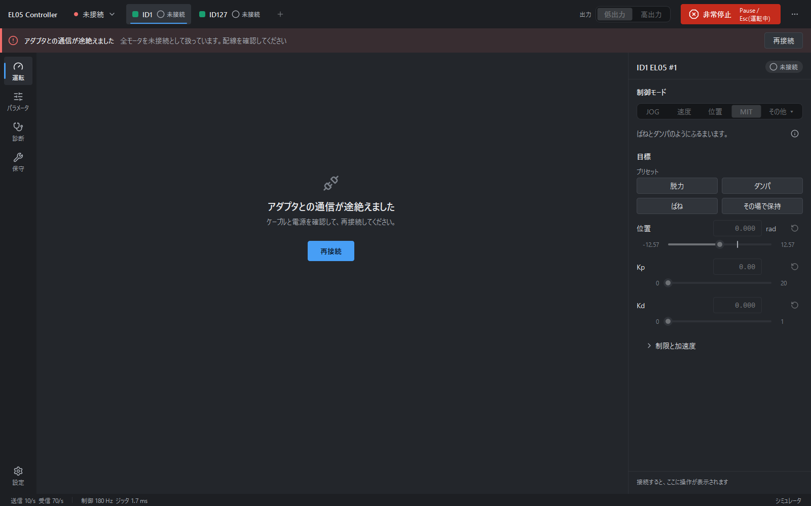

1. USB ケーブルが抜けていないか、アダプタの接続が緩んでいないかを確認します。
2. モータの電源が落ちていないかを確認します。
3. 直ったら、バナーの [再接続] を押します。

1 台のモータだけが応答しないときは、イベントに「ID n: フィードバックが途絶えたため無効化しました」と出て、そのモータが「未接続」になります。電源を入れ直したら、`+`(再スキャン)を押してください。

アプリとの通信が途切れたときにモータが自分で出力を止めるようにするには、保守ページの「通信タイムアウト」を設定します(§8.1)。

### 12.5 故障コード

故障が出ると、モータは無効化されます。診断ページの「故障」(§7.1)に、原因と対処が出ます。

| 故障 | 意味 | 主な原因と対処 |
|---|---|---|
| 低電圧 | 母線電圧が 12 V 未満 | 電源の容量不足、配線の抵抗、電源電圧が低い。1 A の電源で急加速すると起きます。電圧(12 V 以上)と配線を確認 |
| 過電圧 | 母線電圧が 60 V を超えた | 電源電圧が高い、減速時の回生電圧。電源電圧を確認 |
| 過温 | モータ温度が 135 ℃ を超えた | 連続運転、負荷が大きい。無効化して冷まし、温度が下がってからリセット |
| 過電流(A / B / C 相) | 三相電流の過電流 | 軸が拘束されている、負荷が大きい、電流制限が高い。負荷を外し、電流制限を下げる |
| 過負荷 | ストール(拘束)による保護 | 拘束を解く、負荷を軽くする |
| エンコーダ未校正 | エンコーダが校正されていない | メーカーの手順で校正 |
| エンコーダ | 磁気エンコーダの故障 | 配線不良、磁石の位置ずれ。電源を入れ直し、改善しなければ保守が必要 |
| ドライバ IC | ドライバ IC が故障を報告した | 電源・配線の不良。電源を入れ直す |
| ハードウェア識別 / 位置初期化 | 基板の識別・位置の初期化に失敗 | 電源を入れ直す |

リセットは、診断ページの [故障をリセット](CLI では `disable ID --clear-fault`)で行います。原因が残っていると、また故障が出ます。

### 12.6 位置の表示がおかしい

| 見え方 | 説明 |
|---|---|
| 位置の大きな数字が ±12.57 rad で急に反対側へ飛ぶ | 正常です。フィードバックの位置は ±4π で折り返します(§3.4)。「多回転」の値とグラフは、累計の位置です |
| 接続し直すと「多回転」が変わる | 多回転位置は、接続時にモータ内部の mechPos に合わせ直します。以前は接続時の折り返し位置から積算していたので、±4π の外で接続すると 8π ずれていました。いまの値のほうが正しい値です |
| 「多回転位置(mechPos)を読み出せないため有効化できません」と出る | MIT の保持や位置モードの目標は多回転の座標で送るので、多回転位置がずれたまま有効化すると、保持のつもりで約 25 rad 動くおそれがあります。そのため、mechPos を読めないときは有効化を拒否します。通信を確認してください |
| 原点に設定したら、グラフの線が途切れた | 正常です。座標が変わるので、0 への跳びを縦線で結ばないようにしています |
| MIT で「制限中」が出て、ばねが働かない | ±4π 付近の規則です(§3.4)。[⊕ 原点に設定] で解消します |
| 指令を入れたのに、値が小さくなる | 出力段階の上限に制限されています(「低出力上限で制限中」)。必要なら高出力へ切り替えます(§3.1) |
| 手で回した直後に、トルクが一瞬 0.5 N·m を超える | 手で急に動かした瞬間の数 ms は、上限の 1.5–2 倍が出ます(§3.5) |

### 12.7 電流モードで指令どおりのトルクが出ない(Q-P7)

仕様から見積もると、EL05 のトルク定数は約 0.69 N·m/A です。それなら電流モードで Iq を 1 A と指令すれば、0.7 N·m 近いトルクが出るはずでした。
ところが実際に出たのは約 0.07 N·m でした。
同時に読んだ実際の q 軸電流(iqf)は約 0.1 A で、指令の約 1/9 しか流れていません。

トルクの読み値のほうは、どの条件でも「0.62〜0.66 × iqf」で一定でした。トルク定数にすると約 0.65 N·m/A で、仕様の見積もりと合います。
この関係から求めた慣性は電流モードと MIT で同じ値になり、MIT の定常状態の釣り合いとも整合しました。トルクの読み値と、MIT で指定する N·m は正しいと考えられます。
加速度も Iq の指令に比例しているので、制御としては一貫しています。
ずれているのは、電流モードの指令値と実電流の比だけです。この比はモータの減速比に近い値ですが、なぜそうなるのかはまだ分かっていません。

このため、電流モードでは、指令値(Iq)からトルクを計算しないでください。トルクは、読み値か iqf から求めます。
なお、`limit_spd` と `limit_torque` は電流モードを制限しません。速度は暴走ガード(§3.3)が抑えます。

### 12.8 そのほかの症状

| 症状 | 対処 |
|---|---|
| モードが選べない | モータを停止中(無効)にしてください。故障・未接続・非常停止中も選べません(ツールチップに理由が出ます) |
| 書込・保守の操作が押せない | モータが停止中でないか、未接続・非常停止中・故障中です。ツールチップを見てください |
| 高出力にできない | 全モータを無効化し、非常停止を解除し、接続してください(§3.1) |
| 位置を 0 にしたい | [⊕ 原点に設定](§3.4)。ゼロ点は電源を入れ直しても残ります |

---

## 13. 既知の制限・未確認の項目

根拠となる記録は [`design/open_questions.md`](design/open_questions.md) と [`research/hw_bench.md`](research/hw_bench.md) にあります。

| 項目 | 状況 |
|---|---|
| MIT の位置目標が、内部で「折り返し位置」と「多回転位置」のどちらと比べられるか(Q-P12) | 未確認。安全のため、±4π 付近では Kp を 0 にしています(§3.4)。確認には安全制限を通さない生フレームの送信が要るため、判断を待っています |
| 電流モードの実電流(Q-P7) | 実電流は Iq の指令の約 1/9。原因は未解明(§12.7)。トルク定数 Kt は 0.65 N·m/A(実測)。消費電力の推定に使う相抵抗・基本消費は未較正 |
| CAN ID の変更が、電源を入れ直したあとも残るか(Q-P5) | 未確認(ゼロ点は残ることを確認済み) |
| type 22 の保存で値が残るか | 0x70xx は残らない(実測 HW-6。§6.4)。0x20xx の読み書きは未確認(Q-P3) |
| 公式 USB-CAN 経由での「CANopen・MIT プロトコルから戻す」(Q-T1) | 未確認(標準フレームの表し方が未確認)。結果は「未検証」と出ることがある |
| ボーレート変更・プロトコル切替の実機での動作 | 未確認。ボーレートを変えると、このツールからはつながらなくなる |
| 故障フレーム(type 21)をモータが自発的に送るか(Q-P6) | 未確認。故障は、通常のフィードバックの故障ビットから検出している |
| モータ内蔵の CAN 終端抵抗の有無(Q-P9) | 未測定 |
| 2台連動の実機での動作 | 未確認(ベンチのモータは 1 台) |
| 高出力・高負荷 | 24 V 6.25 A の電源までの確認。本格的な高負荷の試験は未実施 |
| 「抵抗ゼロ」「負の Kd」の手応え | 個体差があり、実機での評価は限られている |
| 非常停止 | ソフトウェアによる停止で、物理的な遮断の代わりにはならない(§3.2) |
| 重力負荷のある用途 | 対象外。非常停止は即座に無効化するので、負荷が落ちる |
| `--sim` 以外の通信アダプタ | 実機で確認済みなのは公式 USB-CAN(CH340)だけ。python-can 系(接続ポップオーバーの「汎用 CAN(python-can)」)は、仮想バスでのテストのみ |
| プラグイン | 起動後の追加・削除はできない(次回の起動から)。CLI はプラグインを読み込まない |

---

## 14. 付録: キーボードショートカット

| キー | 働き | 条件 |
|---|---|---|
| Pause | 非常停止 | いつでも |
| Esc | 非常停止 | いずれかのモータが有効・運転中のとき。それ以外は通常の Esc(入力の取消し、ダイアログを閉じる) |
| `Ctrl+1` … | ページ切替(ナビの上から順) | |
| `F5` | 主ボタン(有効化 / 運転開始 / 故障をリセット) | 運転ページ |
| `F6` | 運転停止 | 運転ページ(運転中) |
| `←` / `→` 長押し | JOG の逆転 / 正転 | JOG モードで、インスペクタにフォーカスがあるとき |
| `Ctrl+R` | CSV の記録 開始 / 停止 | 運転ページ |
| `Space` | グラフの一時停止 / 再開 | グラフにフォーカスがあるとき |
| `Enter` | 値の確定 | パラメータの入力欄 |
| `↑` / `↓` | 値の増減(Shift で 10 倍) | パラメータの入力欄 |
| `Enter` / `Shift+Enter` / `↑` `↓` | 実行 / 改行 / 履歴 | スクリプトのコンソール |

---

## 関連資料

| 資料 | 内容 |
|---|---|
| [`design/ui_design.md`](design/ui_design.md) | 画面の設計 |
| [`design/sequences.md`](design/sequences.md) | シーケンスとスクリプトコンソールの仕様 |
| [`design/plugin_guide.md`](design/plugin_guide.md) | プラグインの作り方 |
| [`design/open_questions.md`](design/open_questions.md) | 未決・未確認の事項 |
| [`research/hw_bench.md`](research/hw_bench.md) | 実機での試験記録と、分かった事実 |
| [`research/el05_protocol.md`](research/el05_protocol.md) | CAN 通信プロトコル |
| [`style.md`](style.md) | この文書群の書き方 |
